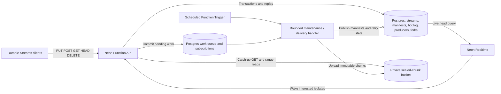

# Investigation: a Durable Streams server on Neon

Implementation update, 23 November: this document records the original investigation. The current [collection contract](reclamation-v1.md) delegates historical object recovery to Neon or matching backups and removes the application's PITR window and safety margin. Current stream offsets, fork references, replay pins, and publication barriers remain protected by the library.

Research date: **2026-11-22**. Status: proposed architecture, based on documentation and source inspection; no deployed experiments yet.

The delivery target is a **production-grade library that users embed in their own Neon-hosted servers**. The [production library design](production-library.md) develops that requirement into a package contract, operating model, and release criteria. This document supplies the protocol and platform analysis underneath it.

## Assessment

The requested division of responsibilities fits the core protocol:

| Component | Responsibility |
| --- | --- |
| Neon Function | Public Durable Streams HTTP API, replay, long-poll and SSE connections; bounded maintenance and delivery work |
| Lakebase Postgres on Neon | Stream index, lifecycle and fork graph, chunk manifest, hot/frozen append records, producer state, subscription state, durable work queue |
| Neon Object Storage | Immutable sealed chunk objects and their embedded indexes |
| Neon Realtime | Notify Function isolates that a stream's tail or lifecycle changed |

Postgres transactions supply the ordering and atomicity that a single-stream actor would otherwise supply. An acknowledged append is durable in Postgres immediately; moving it into Object Storage is a storage optimization. Neither successful object upload nor Realtime delivery is a prerequisite for acknowledging that append.

I recommend a TypeScript library with a Fetch handler, explicit maintenance and migration entrypoints, and a Neon deployment example. Full conformance and production readiness remain engineering targets, not established results. The hardest parts are crash-safe chunk migration, forks and reclamation, race-free live reads, and the durable subscription scheduler. Functions concurrency also limits direct fan-out before storage throughput becomes relevant. The experiments below qualify that production architecture; the intended deliverable is the reusable library.

## Sources and scope

The upstream checkout inspected was commit [`461b40267aabd644558f9b19dbb9507dd5f691cf`](https://github.com/durable-streams/durable-streams/tree/461b40267aabd644558f9b19dbb9507dd5f691cf), the fetched repository HEAD. Its commit date is 2026-09-10. The protocol calls itself draft version 1.0 and retains a placeholder date, so use the commit as the precise compatibility target.

Primary protocol and implementation sources:

- [Protocol specification](https://github.com/durable-streams/durable-streams/blob/461b40267aabd644558f9b19dbb9507dd5f691cf/PROTOCOL.md).
- [Server conformance source](https://github.com/durable-streams/durable-streams/blob/461b40267aabd644558f9b19dbb9507dd5f691cf/packages/server-conformance-tests/src/index.ts), [CLI runner](https://github.com/durable-streams/durable-streams/blob/461b40267aabd644558f9b19dbb9507dd5f691cf/packages/server-conformance-tests/src/test-runner.ts), and [reference-server harness](https://github.com/durable-streams/durable-streams/blob/461b40267aabd644558f9b19dbb9507dd5f691cf/packages/server/test/conformance.test.ts).
- [Reference store](https://github.com/durable-streams/durable-streams/blob/461b40267aabd644558f9b19dbb9507dd5f691cf/packages/server/src/store.ts) and [Cloudflare implementation](https://github.com/durable-streams/durable-streams/tree/461b40267aabd644558f9b19dbb9507dd5f691cf/packages/server-cloudflare).
- [Durable Streams site](https://durablestreams.com/) for product context. Proxy, Durable State, StreamDB, StreamFS, and client implementations build on the server protocol; implementing all those products is outside this server's scope.

Neon claims below were checked against live official documentation, discovered through its [documentation index](https://neon.com/docs/llms.txt). The accompanying [source manifest](research-sources.json) records URLs, content hashes, and available page update dates. These are documentation observations, not independently measured platform guarantees. The npm registry was unreachable from this environment, so published package contents and current npm dist-tags were not verified.

## Protocol obligations

“Full” should cover the inspected protocol, including the subscription functionality that the default suite gates off.

| Area | Required behavior and design consequence |
| --- | --- |
| Create | `PUT` supports initial bytes, empty streams, create-and-close, optional TTL or absolute expiry. Return 201 for creation, 200 for matching configuration, 409 for a mismatch. Repeated PUT must not append its body again. |
| Append | `POST` validates content type and nonempty bodies, supports optional lexicographic `Stream-Seq`, and returns the committed next offset. An empty POST is valid for close-only. Receive and validate a bounded request before taking stream locks. |
| Ordering | Offsets must be persistent, unique, lexicographically increasing tokens. Allocate them under a per-stream database lock, in the transaction that writes the data. |
| Producers | Atomically validate and persist `(stream, producer ID, epoch, sequence)` with the append. New accepted producer writes return 200; duplicates return 204; stale epochs return 403; gaps return 409 with expected/received headers. Partial producer headers are 400. |
| Closure | Persist close and optional final append atomically. Preserve the closing producer tuple for deduplication. Closed data stays readable; EOF appears only once the reader reaches the final offset. |
| Catch-up | `GET` returns a bounded range and resumable `Stream-Next-Offset`; `Stream-Up-To-Date` reflects the captured tail. Honor `offset=-1`, omitted offsets, and `offset=now`. JSON empty reads return `[]`. |
| Long-poll | Require an offset; immediately replay available data, otherwise wait. Timeout returns 204 with next-offset, up-to-date, and an advancing cursor. A closed stream at its tail returns EOF immediately. |
| SSE | Emit `event: data`, followed by `event: control` with next-offset and cursor/up-to-date/closure fields. Binary content uses base64 and the encoding header. Close the connection after final EOF; ordinary connections should rotate around 60 seconds. |
| JSON | Validate JSON; flatten exactly one array level per append; preserve logical message boundaries. Read as one JSON array across chunks and fork boundaries. POST `[]` is 400, while PUT `[]` creates an empty stream. |
| HTTP | Correct metadata-only HEAD, MIME/header case handling, content-type mismatch handling, conditional reads/304, ETags that change on closure, cache policy, CORS, and browser response headers. |
| Expiry | Sliding TTL and absolute expiry are distinct. Expired streams must become inaccessible on time even if physical cleanup runs later. Fork references may require retaining their data internally. |
| Forks | Same-server source, explicit/default divergence offset, binary-byte or flattened-JSON-message sub-offset, independent appends and lifetime, recursive inherited reads, fresh producer and Stream-Seq state. |
| Fork deletion | A referenced deleted source returns 410 directly and blocks recreation with 409, while its forks remain readable. Reclaim transitively only when no dependent forks remain. |
| Subscriptions | Reserved `__ds` routes, idempotent normalized configuration, glob and explicit stream membership, durable ack cursors, generation fencing, leases, pull-wake delivery, signed webhooks, callbacks, retries, and JWKS. |

Some details are easy to miss:

- `Stream-Closed` means true only when its value is exactly `true`, case-insensitively. Other values are ignored.
- `Stream-Up-To-Date` means caught up, not EOF. A close without a new append still changes ETags and must wake readers.
- Producer retry identity is the tuple, not a body hash. Retrying a closing tuple must not append again, even if its body changes.
- Sequence comparison must be bytewise. Use a deliberate C/binary comparison for `Stream-Seq` and offset text, rather than the database's default locale collation.
- Forks share the source offset space until divergence. A seal operation must never renumber offsets.
- A fork at its tail waits for its own appends; later source appends must not wake it with source data.
- The protocol leaves URL layout open, but the suite constructs `/v1/stream/...` paths. Reserve `/v1/stream/__ds/...` before routing ordinary streams.
- `Stream-Seq` may be scoped per writer or per stream; document the choice. Per stream is the simplest initial policy.

### Ambiguities to track explicitly

The specification broadly describes TTL renewal on reads, but the suite explicitly requires that **HEAD does not renew TTL**. Follow the tested GET/POST behavior and keep HEAD observational.

The TTL prose also says live-read renewal happens when the request begins, while claiming active live readers prevent expiry. A quiet connection held longer than its TTL makes those statements difficult to reconcile. Test this against the reference implementations, record the chosen behavior, and raise the ambiguity upstream. A possible implementation is an expiring active-reader lease that renews sliding TTL while the connection exists; it must never extend absolute expiry.

The spec discourages reusing a deleted URL, while the suite requires hard-delete/recreate and expired-stream recreation to work. Support recreation with a new internal stream UUID and generation so producer state, waiters, caches, and pending jobs cannot attach to the replacement. Soft-deleted referenced sources remain blocked.

Subscription acks are described as last-processed inclusive, while read cursors denote the position after returned data. Use server-issued returned boundaries and test ack/read interoperability carefully rather than adding or subtracting from opaque tokens.

## Neon capabilities and limits

### Functions

[Runtime limits](https://neon.com/docs/compute/functions/reference/runtime-limits.md) currently document:

- Node.js 24 and web-standard `fetch(Request): Response` handlers; multiple concurrent requests per process and multiple independent isolates under load.
- 2,048 MiB memory per isolate.
- 15 minutes to first byte, 15 minutes of connection silence before timeout, and a 15-minute `waitUntil` lifetime.
- Operational eviction at any time; SIGINT followed by forced termination after five seconds.
- An account-wide default of **100 concurrent invocations**; excess traffic gets 429 with `Retry-After`.

SSE and long-poll fit the documented execution model. Send SSE comment heartbeats, initially every 20–25 seconds, and rotate connections around the protocol's recommended 60 seconds. Heartbeats do not create durable data or advance offsets. Measure actual flushing through the deployed ingress, including low-volume streams.

Treat open SSE/long-poll requests as occupying invocation capacity and prove the accounting in a deployment test. Leave headroom for appends, replay, maintenance, and subscription delivery. One hundred open readers is therefore not a safe target on the default limit. Realtime's own fan-out does not remove this limit when clients reach it through the Durable Streams Function.

Use module-scope `pg` pools with a small maximum, and the Functions pool lifecycle helper. Use one checked-out client for an entire transaction; never distribute its statements over `pool.query`. PgBouncer transaction pooling supports normal transaction-scoped work; direct connections are needed for session facilities such as LISTEN. Do not hold a connection or transaction while waiting for live data or fetching object storage. See [connection pooling](https://neon.com/docs/connect/connection-pooling.md).

Functions and Object Storage are documented in `aws-us-east-2`, `aws-us-east-1`, `aws-eu-central-1`, and `aws-ap-southeast-1`. These are also the current Realtime regions. Frankfurt is a reasonable candidate for this investigation, subject to the eventual project's requirements. Projects with IP Allow or Private Networking do not support this Functions-to-Postgres/Realtime combination as described in the docs.

### Realtime

The [overview](https://neon.com/docs/realtime/overview.md) currently says:

- Beta, available on all plans, with **Postgres 18 required**; other major versions, including 19, are unsupported.
- Initial enablement turns on logical replication project-wide and restarts all computes on all branches. It is not a harmless toggle on an existing busy project.
- Live SQL supports deterministic read-only queries. Primary keys provide the required stable replica identity. Tables with RLS enabled are rejected.
- Holding subscriptions open permits database scale-to-zero; initiating a live query wakes compute. Periodic SQL fallback reads will keep waking it.
- There are no beta performance guarantees. Realtime service fees are waived during beta, while database and egress usage can still be billed.

Use the supported SDK rather than the evolving raw WebSocket protocol. The current [backend SDK](https://neon.com/docs/realtime/sdks/typescript/backend.md) supports direct subscriptions:

```ts
import { createRealtime, rawSql } from '@neon/realtime/server'

const realtime = createRealtime({
  url: process.env.NEON_REALTIME_URL!,
  secret: process.env.NEON_REALTIME_SECRET!,
  db: 'neondb',
})

// trustedStreamId is resolved after the Function authorizes this reader.
const subscription = await realtime.subscribe(rawSql(
  `SELECT id, tail_offset, change_version, closed, deleted
     FROM durable_streams.ds_streams WHERE id = $1`,
  [trustedStreamId],
))
```

This is an illustrative API shape, not a tested integration. The direct SDK multiplexes subscriptions over a shared connection and automatically renews sealed capabilities. Its documented Node setup also uses `ws`; verify the exact dependency versions during implementation.

The [subscription lifecycle](https://neon.com/docs/realtime/guides/subscribing.md) distinguishes initial results, incremental changes, whole-result replacements, reconnects, and terminal errors. A reconnect can replace the whole result. An awaited `subscribe()` has minted the capability; it does **not** by itself prove the first authoritative rows have arrived. Terminal errors require recreating the subscription/client as appropriate.

Subscribe to a **small durable stream head**, rather than the accumulating hot bytes. A tail/version change tells the Function to read from its durable offset. This avoids treating result-set deltas as an event log, transferring a growing hot blob to every isolate, or losing data when hot rows disappear during sealing. Keep a subscription only while that isolate has interested readers and share it among readers of the same stream.

The Functions environment-variable table does not explicitly list the two Realtime variables. Verify deployed injection; if necessary provide branch-specific Function settings with application-owned variable names. Do not assume local `env pull` proves deployed availability or reuse a parent branch's secret accidentally.

### Object Storage

[S3 compatibility](https://neon.com/docs/storage/s3-compatibility.md) covers PUT, GET, HEAD, DELETE, listing, byte-range GETs, multipart uploads, and presigned access. Use SigV4 and path-style addressing (`forcePathStyle: true`). A private bucket keeps the Function responsible for protocol/auth behavior.

The [current limits](https://neon.com/docs/storage/overview.md) are 5 GiB for single-request uploads and 10 GiB with multipart. Proposed stream chunks should be vastly smaller. Lifecycle rules and versioning configuration are accepted but **not enforced**, so implement reclamation yourself and use immutable keys. Keep application checksums; do not assume a multipart ETag is a content checksum. Validate read-after-upload behavior and range correctness experimentally before relying on immediate manifest publication.

[Buckets branch copy-on-write](https://neon.com/docs/storage/buckets.md). New environment branches can inherit database rows and objects without bulk copying. However, the same page explicitly says a **Postgres restore leaves buckets and objects unchanged**. Environment branching and cross-service transactionality are separate concerns.

### Maintenance triggers

[Function Triggers](https://neon.com/docs/compute/functions/triggers/overview.md) support scheduled and object-created invocations. Deliveries can duplicate, arrive out of order, and eventually be discarded after retry exhaustion. They can wake suspended resources, but are not the durable record of pending application work.

Use a Postgres work table as that durable record. `waitUntil` can opportunistically drain it after append, and a scheduled Function can recover abandoned work. [Scheduled triggers](https://neon.com/docs/compute/functions/triggers/schedule.md) use five-field UTC cron, down to **one minute**, with no seconds field. This is sufficient for seal/cleanup recovery, but alone does not establish prompt recovery of one-second webhook retries and leases after an isolate dies.

## Proposed architecture



The library should expose separate API and maintenance entrypoints. The recommended production template deploys them as separate Functions so their credentials, time budgets, and application admission policies can differ. Both still share Neon's account invocation limit. External clients see standard Durable Streams HTTP; they do not need Neon-specific transports or credentials.

### Logical schema

This is a design sketch, not an executable migration:

| Table | Main fields and invariants |
| --- | --- |
| `ds_paths` | Persistent namespace claim keyed by installation/tenant/canonical path, with the active stream UUID. Insert-or-find and lock this row for lifecycle coordination, including nonexistent paths; revalidate the resolved generation. |
| `ds_streams` | UUID identity, installation/tenant/path, generation, content type, tail offset, current hot chunk, change version, last Stream-Seq, closed/closed-by, TTL/last access/absolute expiry, lifecycle. `ds_paths` owns active-path uniqueness; recreated paths receive new UUIDs, with historical generations retained as needed. |
| `ds_chunks` | UUID, owner stream UUID, ordinal, start/end offsets, state HOT/FROZEN/SEALED, byte/message counts, immutable object key, format version, checksum. One HOT chunk per stream via a partial unique index. Manifest order is indexed by stream and offset. |
| `ds_hot_appends` | Stream/chunk UUID, append ordinal, start/end offsets, payload `bytea`, message-boundary metadata. Unique stream/end-offset. Includes FROZEN data until migration publishes. |
| `ds_producers` | Primary key `(stream_id, producer_id)`, epoch, last accepted batch sequence, update time. Retain with the stream rather than expiring eagerly. |
| `ds_fork_edges` | Unique child stream, parent UUID, anchor offset, original sub-offset, resolved boundary/prefix metadata. Referential integrity prevents premature parent removal. |
| `ds_jobs` | Durable seal/GC/delivery intent, idempotency key, available-at, attempt count, lease owner/expiry, error. Indexed for runnable work; reclaimed after worker crashes. |
| `ds_subscriptions` | UUID/name, normalized configuration hash, delivery type, generation, wake identity, holder/token metadata, lease deadline, retry deadline/status, deletion tombstone. |
| `ds_subscription_streams` | Subscription/stream relationship, explicit/glob membership flags, acked offset. Preserve explicit precedence while allowing removal to reveal remaining glob membership. |
| `ds_wakes` / outbox | Durable snapshot of a wake generation and the work still needed to publish it to a wake stream or webhook. |
| `ds_stream_changes` | Bounded change outbox entry per stream mutation: installation/stream UUID, stream-local version, before/after offsets, lifecycle, processing state. Drives resumable subscription matching/fan-out without scanning all subscriptions in the append transaction. |
| Object lifecycle / read pins | Object publication intent, immutable identity, LIVE/RETIRING/deletion state, and bounded reader lease records. The exact schema and shared reference-acquisition protocol are an M0 design deliverable before destructive GC is implemented. |

The “hot chunk” should initially be a **logical chunk of append rows**, rather than one ever-growing `bytea` updated on every token. Repeated concatenation rewrites growing values, increases WAL and vacuum pressure, and makes live byte subscriptions expensive. Per-append rows still provide exactly the hot-chunk abstraction requested; sealing packs them into an object. Benchmark this against bounded blob updates before committing to a more complex optimization.

Keep payload data as bytes, including a precisely defined JSON representation and its message boundaries. `jsonb` alone is insufficient as the universal log representation. An append may carry several flattened JSON messages while remaining one producer batch; retain both concepts for fork sub-offsets.

### Append transaction

1. Authorize the request and validate/receive its bounded body. Parse JSON and producer syntax before holding a row lock.
2. Begin an explicit READ COMMITTED transaction on one checked-out connection, set transaction-local synchronous commit on and bounded timeouts, acquire the path claim, resolve/revalidate the stream generation, and lock its row `FOR UPDATE`. Enforce expiry/lifecycle, content type, Stream-Seq policy, producer fencing/deduplication, and closure semantics in documented order.
3. Allocate next-offset from the committed tail. Insert append rows; update producer state, tail, change version, and optional closure in the same transaction.
4. If a rotation threshold was crossed, mark the old chunk FROZEN, allocate a new HOT chunk, and insert a unique seal job. Large individual appends need an explicit bound and oversized-chunk policy.
5. Record a bounded stream-change outbox entry transactionally. Durable maintenance performs subscription matching/fan-out using an explicitly defined registration/backfill handoff; it must not scan all subscriptions inside the append transaction. A committed append remains discoverable after a crash before any post-response callback runs.
6. Commit, then respond. Realtime observes committed head changes; post-response work may accelerate sealing/delivery but is recoverable from the tables.

Serializing all writes per stream is stronger than the per-producer minimum and makes total stream order straightforward. Separate streams proceed independently. This does impose a single hot-stream throughput ceiling; microbatching can amortize commits later. Do not assume transactions reorder producer requests that arrive out of sequence: a gap remains a gap, and the client retries it.

### Offsets and chunk format

Keep protocol offsets independent of HOT/FROZEN/SEALED placement. Never use physical row addresses, object URLs, commit timestamps, or a newly numbered chunk as the public cursor.

The reference/Cloudflare format is two zero-padded 16-digit fields separated by `_`; payload framing advances its byte coordinate by payload length plus five bytes. Reusing this scheme reduces translation risk, but the protocol permits other opaque sortable schemes. If adopted, implement arithmetic with exact integers and explicit overflow bounds, rather than copying JavaScript Number arithmetic blindly.

A sealed object should contain a versioned header, stream/chunk identity, ordered frames with persistent start/end offsets, logical JSON message boundaries where applicable, a sparse offset-to-byte index, and a checksum. Initially fetch whole modest-sized objects; add range reads once replay correctness is stable. Compression must preserve seekability, e.g. independently compressed blocks, if byte-range reads are expected later.

### Recoverable sealing

```mermaid
stateDiagram-v2
    HOT --> FROZEN: Rotation transaction creates new HOT and seal job
    FROZEN --> FROZEN: Upload or worker fails; Postgres copy remains readable
    FROZEN --> SEALED: Object verified; manifest and local-copy removal commit together
```

1. Claim a seal job with a short database lease, using `FOR UPDATE SKIP LOCKED`. Commit the claim before external I/O.
2. Read the frozen, immutable records and build/upload a deterministic object under a key containing its installation, stream/chunk UUIDs, format version, and content hash. The hash prevents a restored HOT chunk with the same UUID but a different eventual body from overwriting an earlier object. Retry uploads safely; workers must produce identical bytes for the same content identity.
3. Validate availability, size, and checksum. Open a short transaction and verify stream generation, chunk state, and job lease/version.
4. Publish the object key/checksum and mark SEALED; remove the matching Postgres payload rows atomically with that manifest update. Complete the job.

A failure before publication leaves readable Postgres data; a failure after upload may leave an orphan object that a later retry adopts or GC reclaims. A failure after commit leaves the object authoritative. Keep object I/O outside the stream append lock.

GC must coordinate with in-flight seal jobs. It cannot delete an uploaded object that a live worker can still publish, nor allow a stale worker to resurrect a deleted generation. Require lease/state checks and a generous orphan grace period. Track failures and frozen backlog; if storage is unavailable, apply deliberate backpressure before Postgres fills, while preserving already acknowledged data.

### Replay without seal races

Resolve a read plan from one short consistent database snapshot: stream identity/lifecycle, visible tail and closure, manifest, inherited fork ranges, and any needed HOT/FROZEN bytes. Copy the bounded database payload before releasing the snapshot. Then fetch referenced immutable objects and emit data.

This prevents a mixed read that observes a pre-seal manifest but post-seal missing hot rows. Avoid holding a database transaction throughout object downloads or an SSE connection. For paginated replay, repeat with the last returned offset; each batch has its own captured tail and correct up-to-date/EOF flags.

Objects referenced by an existing read plan must survive until that bounded read completes. Coordinate read-pin acquisition with an atomic object-retirement barrier, and define expiry/renewal for bounded verified read pages. A grace period supplements this protocol. Fork references, pending publication, and restore retention are independent reasons to keep an object. Destructive GC stays disabled until the acquisition/deletion races are tested.

Initially proxy object bytes through the Function. A raw presigned S3 redirect alone does not supply Durable Streams framing, JSON arrays, inherited-range stitching, offsets, or all response headers. A CDN for immutable protocol responses is a later optimization with a validated authorization/cache-key policy.

### Live reads without missed wakeups

For each actively watched stream in an isolate:

1. Install a shared head subscription and local waiter registration before the final durable catch-up check. Track every notification with a local version/dirty marker.
2. Obtain the initial authoritative subscription state, or enter a bounded SQL fallback if Realtime is unavailable. Re-read durable state after establishing the watcher.
3. Drain persisted data from the client's offset, ignoring coalesced or repeated notifications. Snapshot replacement is a reason to re-check state, not a new log entry.
4. Before sleeping, atomically compare the local wake version with the one observed before the durable read. If it changed, read again; otherwise wait for change, timeout, expiry, or cancellation.
5. Re-check durable state on reconnect, subscription error, and a bounded fallback timer. Coalesce reads among local readers where practical. Cancellation must release waiters, buffers, and subscriptions.

Correctness comes from replaying offsets, not counting Realtime messages. Lost or delayed notification affects latency only when the fallback and reconnect paths work. Read-your-writes uses the primary Postgres endpoint; do not wait for the asynchronous Realtime replica to catch up before serving a committed append.

SSE comment heartbeats, a long-poll timeout, and Realtime recovery are separate timers. Bound buffers for slow consumers and disconnect them with their last confirmed protocol offset available for replay. A deployment eviction may cut a frame; clients resume from the last completed control boundary.

### Forks and lifecycle

Lock source/target identities in a consistent order and create the target plus parent edge in one Postgres transaction. Resolve default tail and inherited expiry from that protected source state. Repeated fork creation must compare the effective configuration and original sub-offset without incrementing references twice.

Inherited ranges reference parent UUIDs and offsets, not mutable paths. Resolve recursively; cap each parent range at its fork boundary. A source's later appends are excluded. For a sub-offset inside a binary append or JSON batch, materialize only the inherited prefix into the child's first owned frame, using the reference semantics. Preserve the original request fields for idempotent recreation checks. Producer and Stream-Seq state start fresh.

Deleting or expiring a referenced source changes its public lifecycle while retaining internal data. Removing the last child edge can enqueue cascading cleanup. Prefer an edge table and transactional existence checks over an unprotected refcount. Test ancestor deletion, path recreation, concurrent fork/delete, and queued sealing together.

A Neon **environment branch** is different from a protocol **stream fork**. Creating an entire Neon branch per stream fork would not implement the intended per-stream graph and shared service namespace.

### Subscriptions and durable delivery

The current protocol includes more than watching hot appends. Its subscription state machine requires:

- Normalized configuration hashing for idempotent create, glob matching/backfill, explicit membership, and per-stream durable ack cursors.
- Exactly one current wake/lease per subscription, with monotonically increasing generation and unique wake identity. Row locks and conditional updates fence stale owners.
- A durable wake snapshot. Synchronous webhook `{done:true}` acknowledges only that snapshot; later appends cause another wake.
- Pull-wake publication to an explicitly created ordinary durable JSON stream. Publication and its outbox completion should share a transaction or use an idempotent internal append identity, so crashes cannot lose the wake.
- Persisted retry deadlines, exponential backoff from 1 to 60 seconds with 20% jitter, lease expiry, and recoverable pending delivery. Deleting a subscription invalidates outstanding callbacks and claims.
- Ed25519 signing of the exact webhook body, persistent keys, public JWKS, rotation overlap, and subscription/generation-scoped callback or claim tokens. Enforce the protocol's webhook URL checks.

Use immediate bounded draining while handling relevant requests and durable jobs for recovery. A minute cron is a recovery sweep, not evidence of one-second retry behavior. The early spike must establish whether a bounded self-restarting Function worker plus scheduled recovery is acceptable, or whether a stronger wake/scheduling facility is needed. Document the maximum recovery delay after total worker eviction; do not hide it behind an in-memory timer.

### Restore and reclamation

Immutable keys prevent a Postgres restore from pointing to changed bytes, but they do not prevent it from pointing to deleted bytes. Retain sealed objects for at least the oldest recoverable database state that might reference them, covering configured history, snapshots/backups, fork dependencies, and active readers. Unbounded snapshot retention needs an explicit object-retention policy.

Also test a restore across a sealing transaction: an older database can contain the pre-seal HOT/FROZEN copy, while a later object remains present as harmless extra storage. Reconcile restored job leases and queues before resuming work.

Branch creation/reset should be tested while sealing is in flight. The docs describe coordinated inheritance, but this investigation does not establish the precise cross-service snapshot ordering under concurrent publication. Never infer a distributed transaction across Postgres and S3 from branch support.

## Conformance and validation plan

### Pin the suite and enable its full scope

The inspected package metadata says `@durable-streams/server-conformance-tests` version 0.3.7. Its current source has the six reserved-subscription cases behind `describe.runIf(options.subscriptions)`. The CLI's runner calls `runConformanceTests({baseUrl})` without enabling that flag. A green default CLI run therefore does not establish the requested complete target.

Use the pinned upstream source/build until the equivalent published artifact is verified, then lock the actual package version and integrity. Example harness shape:

```ts
import { runConformanceTests } from '@durable-streams/server-conformance-tests'

runConformanceTests({
  baseUrl: process.env.CONFORMANCE_BASE_URL!,
  subscriptions: true,
  longPollTimeoutMs: 20_000,
})
```

The server's configured long-poll timeout must fit the harness budget. `longPollTimeoutMs` is a test timeout, not remote server configuration. A local test configuration around 500 ms matches the reference harness and keeps iteration fast.

The six gated cases cover webhook creation/reconfirmation and JWKS, unsafe URL rejection, signed synchronous completion, callback fencing, explicit membership, and pull-wake claim/ack/release. They do not exhaust crash recovery and scheduler behavior. Upstream README pass counts are historical claims, not results for this server.

The webhook fixtures bind `127.0.0.1` on the **test runner's machine**. The unchanged full suite now runs its coordinator and webhook fixtures together inside a Neon Function beside the real data services. Separate deployed ingress tests use a reachable HTTPS receiver. See [colocated conformance](neon-conformance-v1.md) for the implemented workflow.

The suite also issues unauthenticated requests and does not expose a general auth-header option. Run it against a disposable isolated test deployment/local handler configured for the harness; keep deployed authorization tests separate. It must not require making a production endpoint open.

### Validation layers

| Layer | Evidence needed |
| --- | --- |
| Protocol | Unmodified pinned server suite with subscriptions enabled; preserve test output, skips, source commit, and seed on failure. |
| Neon integration | Same handler using a disposable PG18 branch, real Object Storage, and Realtime. Force tiny chunk thresholds so ordinary tests exercise sealing and inherited sealed reads. |
| Deployment | Real Function ingress: header preservation, binary bodies, SSE flushing, cancellation, cold starts, idle timeouts, concurrency accounting, and cross-isolate fan-out. |
| Crash safety | Kill workers before/after commit, upload, publication, and outbox delivery. Restart, retry producer tuples, compare byte-exact replay and stable offsets. |
| Fork/GC | Delete and expire sources during reads/sealing, recursive forks, partial JSON/binary forks, child cleanup, stream recreation, object retention. |
| Realtime faults | Disconnect/recreate subscriptions; append during watcher setup; tolerate snapshot replacement/coalescing; prove durable fallback and bounded delivery lag. |
| Subscription faults | Lease loss, expired/stale tokens, webhook retry after restart, callbacks racing deletion, wake publication crash, append after a wake snapshot. |
| Restore/branching | Branch during upload/publication, restore across sealing and deletion, and verify every restored manifest reference still resolves. |

The client conformance package is for client implementations and adapters. This project primarily needs **server** conformance, plus a few real SDK integration examples; running client conformance does not substitute for server validation.

## Performance and cost questions

The architecture economizes on retained bytes but adds a transaction and index maintenance per append, read-side stitching, Realtime processing, and a migration pass over every sealed byte. A single extremely hot stream serializes on its stream row. Many quiet streams can be dominated by per-stream metadata, query subscriptions, and tiny objects.

Initial tunables to benchmark, rather than promises:

- Seal at 1, 4, and 16 MiB; also seal by age so quiet completed streams do not remain hot indefinitely. A small bounded read response can span or stop inside a physical chunk.
- Test append bodies of 100 B, 1 KiB, 64 KiB, and the declared maximum; include binary and batched JSON.
- Compare one hot stream with many writers against many streams, and 1/10/50 concurrent readers within the default invocation budget. Request a limit change before larger deployed fan-out tests.
- Measure commit-to-first-byte p50/p95/p99, append throughput, cold start, lag after Realtime recovery, seal backlog age, Postgres growth/WAL/vacuum, object GET amplification, and Function memory/connection counts.
- Measure cost with idle live connections and with fallback polling. Realtime's scale-to-zero support does not imply an open Function stream is free.

Useful estimates: object uploads per second are approximately append bytes per second divided by target chunk bytes, with age-based sealing adding extra small objects. Hot storage is approximately incoming bytes per second times time until successful sealing, plus row/index/WAL overhead. A storage outage makes that residence time grow until backpressure or recovery.

[Published pricing](https://neon.com/pricing.md), as retrieved on the research date, lists Postgres storage at $0.35/GB-month and Object Storage at $0.023/GB-month, before other costs—about a 15× volume-rate difference. That is a reason to investigate tiering, not an overall savings forecast. Database history and vacuum mean deleting a hot row does not immediately erase all billed historical bytes.

The same page lists paid-plan public egress at 500 GB per project included, then $0.10/GB, shared by Postgres, Object Storage, and Functions; Functions at $0.60/million invocations plus active/waiting Capacity-Hours; Object Storage has no per-operation fee; Realtime is free during beta. Confirm classification of storage-to-Function and database-to-Function traffic and the meaning of Capacity-Hour under multiplexed streams before projecting spend. Do not multiply or waive internal traffic charges by assumption.

## Recommended implementation sequence

The [implementation plan](implementation-plan.md) is the current sequence, updated after the [plan review](plan-review.md). Establish executable local tests and persistent contracts first; build durable append/producer behavior; prove sealing and restart replay early; then complete live reads, forks/GC, subscriptions, and release qualification. Platform experiments run early alongside the foundation. Package boundaries, migrations, storage formats, and fault tests accompany the first implementation.

Use the upstream reference store and Cloudflare server as behavioral references. The reference server is an HTTP test server with concrete in-memory/file stores, not a documented drop-in async Postgres storage adapter. The Cloudflare implementation has useful separated producer, JSON, cursor, and framing helpers, but its synchronization and timers rely on Durable Objects/SQLite/alarms. Port the semantics to database transactions and durable jobs; moving the same synchronous code into a Function would lose those guarantees. Preserve Apache-2.0 license/notice attribution for any reused code.

The decision after the first spike should be concrete: whether the deployed primitives can meet the desired live-reader capacity and subscription recovery latency. Core stream correctness has a clear implementation path; those platform limits determine the useful operating envelope.
